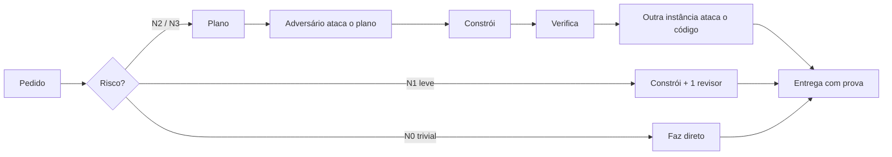

<div align="center">


# Seiva

**Pare de confiar no "pronto" da IA. Exija a prova.**

Uma skill para agentes de programação que organiza o trabalho pelo risco: planeja, constrói, manda **outra instância** revisar e só fecha com evidência. Gasta menos tokens no total, não só por token.

[Instalar em 1 minuto](#instalação) · [Como funciona](#como-funciona) · [Seja testador](#seja-testador) · [Fluxo completo](SKILL.md)

</div>

---

## O problema

Você pede uma tarefa média a um agente de código e acontece uma destas coisas:

- ele diz "pronto" e ninguém conferiu;
- quem escreveu o código é quem aprova o código;
- a sessão cai no meio, e a retomada refaz o que já estava certo (ou aceita um relatório velho como se fosse novo);
- o modelo mais barato gasta três vezes mais tokens para chegar lá;
- um bug que já voltou duas vezes é tratado como tarefa trivial.

A Seiva é um protocolo que corrige isso **sem instalar hook, agente global nem configuração em toda sessão**. Ela só entra quando a tarefa pede.

## Como funciona

A Seiva classifica o risco e usa **só os papéis necessários**. Tarefa pequena segue direto; tarefa sensível ganha plano, ataque ao plano, construção, verificação e ataque ao código.



| Nível | Quando | O que acontece |
|---|---|---|
| **N0** | pergunta, texto, ajuste óbvio | o orquestrador faz e roda a verificação |
| **N1** | 1 a 3 arquivos, fácil de desfazer | verificação e revisão curta |
| **N2** | feature ou bug de vários arquivos, regra de negócio | plano, ataque ao plano, prova, ataque ao código |
| **N3** | permissão, migration, dinheiro, imposto, o que sai do sistema, produção, bug que voltou | tudo acima, com adversário mais forte, outro modelo na verificação e plano de volta |

### O que ela faz diferente

- **Quem constrói não aprova.** Outra instância, de contexto limpo, revisa. A Seiva diz o nível de independência que teve de verdade, e quando o ambiente não consegue dar o que a tarefa exige, ela avisa em vez de fingir.
- **Prova antes de "pronto".** Um relatório existente não prova conclusão. A tentativa precisa de artefato válido, hash e marcador final escrito pelo agente. Relatório velho não passa.
- **Sessão que cai não perde o trabalho.** O estado fica em `estado.json`. Tentativa sem sinal vira `interrompida` sozinha, com os tokens gastos anotados, e nada é redisparado sem decisão. Um vigia limitado à tarefa avisa na hora.
- **Comando para o que é mecânico.** Contar, extrair, calcular hash e montar diff não gastam modelo.
- **Modelo escolhido por papel e por consumo total.** Preço menor por token não é menos tokens. O relatório registra o modelo que realmente rodou, e tarefa sensível nunca é rebaixada para caber no saldo.
- **Contexto sob controle.** Pacote mais contexto herdado acima de 150 mil tokens recusa o disparo: divide a tarefa ou começa outra sessão.
- **Resina, o hacker defensivo.** Rastreia entrada → validação → autorização → destino sensível, procura caminho de abuso e propõe conserto. Só lê; prova executável exige ambiente isolado, dados sintéticos e autorização.
- **Limitação nunca fica escondida.** Dado ausente não é zero, autoconferência não é revisão independente, estimativa não é medida.

## Ela aprende sem se descontrolar

A Seiva melhora com o uso, em dois canais que **nunca se misturam**:

| | Canal A · sua instalação | Canal B · o repositório |
|---|---|---|
| **O que faz** | ajusta parâmetros de uma lista fechada (tempo de sinal, limite de contexto, notas por lente) | propõe uma melhoria conceitual à Seiva |
| **Automático?** | sim, com evidência de duas tarefas, um ajuste por vez e reversão sozinha se piorar | **nunca** |
| **Consentimento** | linha no fechamento diz o que está valendo | você revê a ficha exata (título, corpo, canal, visibilidade) e autoriza uma a uma; recusa ou silêncio não envia |
| **O que sai da sua máquina** | nada | só o conceito de um catálogo fechado, sem caminho, log ou hash do seu projeto |

Detalhes: [ajustes locais](referencias/ajustes-locais.md) · [aprendizado](referencias/aprendizado.md).

## Instalação

Como skill pessoal do Claude Code:

```bash
git clone https://github.com/JulianoSSR/seiva.git ~/.claude/skills/seiva
```

Como plugin:

```text
/plugin marketplace add JulianoSSR/seiva
/plugin install seiva@seiva
```

Em outras ferramentas, use o diretório de skills do próprio ambiente. O núcleo não depende de um aplicativo: integrações (Claude Code, Codex e outras) entram sob demanda, e a Seiva confere o que a sessão realmente permite antes de contar com subagentes, escolha de modelo ou isolamento. Veja [integrações](referencias/harness.md).

Requisitos: `git`, `bash` e Python 3 (só biblioteca padrão). Os scripts de estado usam `fcntl`: Linux ou macOS; no Windows, WSL.

## Primeira tarefa

```text
/seiva corrige o bug de ... em ...
```

ou apenas: *"usa a seiva para implementar ..."*. Ela lê as regras do seu projeto, mostra o nível, os motivos e o orçamento antes de começar e pergunta só o que for decisão sua. Autorização que você já deu continua valendo.

## Seja testador

A Seiva é jovem e **precisa de uso real para melhorar**. Se você usa agente de código em projeto de verdade, sua ajuda vale muito:

1. Instale e use em **uma tarefa média** (N2 é o ponto ideal: vários arquivos, uma regra de negócio).
2. Abra um [relato de teste](https://github.com/JulianoSSR/seiva/issues/new?template=relato-de-teste.md) contando: nível escolhido, se a revisão achou algo que você não teria visto, onde ela atrapalhou ou gastou demais, e se algo foi interrompido.
3. Se ela errou o nível, deixou escapar um defeito ou pediu coisa demais, **isso é o mais valioso**: conte.

O que ajuda: relato honesto, bom ou ruim. O que a gente não quer: número de economia sem fonte.

### Estado atual, sem enfeite

- **Testado:** o protocolo, o estado de tarefa, os ajustes locais e os scripts têm testes automatizados determinísticos (`bash scripts/testar.sh`), sem chamar modelo.
- **Não demonstrado:** economia real de tokens. Não há ainda comparação pareada em tarefas completas; o protocolo de avaliação está em [AVALIACOES](docs/AVALIACOES.md) e o resultado, por ora, é inconclusivo. É exatamente esse dado que os testadores ajudam a produzir.
- **Integrações:** Claude Code é a mais usada; Codex tem consulta real de catálogo e quota; Gemini CLI, OpenCode e Cursor estão simulados por fixture, sem execução real. A tabela completa está em [harness](referencias/harness.md).

## Medição e limites

Notificação de agente é aviso de término, não contabilidade. A medição separa entrada, saída e cache, atribui ao intervalo da tarefa e marca o que é estimado ou indisponível. Antes e depois de cada tarefa, o `usage` registra a diferença para você comparar uma tarefa com a seguinte. Sem fonte detectada, a Seiva declara a lacuna; não inventa zero.

[Modelos e custo](referencias/modelos.md) · [Retomada](referencias/retomada.md) · [Fluxo completo](SKILL.md)

## Privacidade

Pacotes, relatórios de execução, transcripts e aprendizado local ficam em pasta ignorada pelo git. Nada do seu projeto sobe para o GitHub sem a autorização exata da ficha. Documentação, casos sintéticos e avaliações sanitizadas podem ser versionados.

## Contribuir

Propostas precisam de **caso real, custo esperado e caso de teste**. Veja [CONTRIBUTING.md](CONTRIBUTING.md), [testes/casos.md](testes/casos.md) e [fontes](FONTES.md).

---

<div align="center">

MIT · [LICENSE](LICENSE) · feito por [JulianoSSR](https://github.com/JulianoSSR)

</div>
